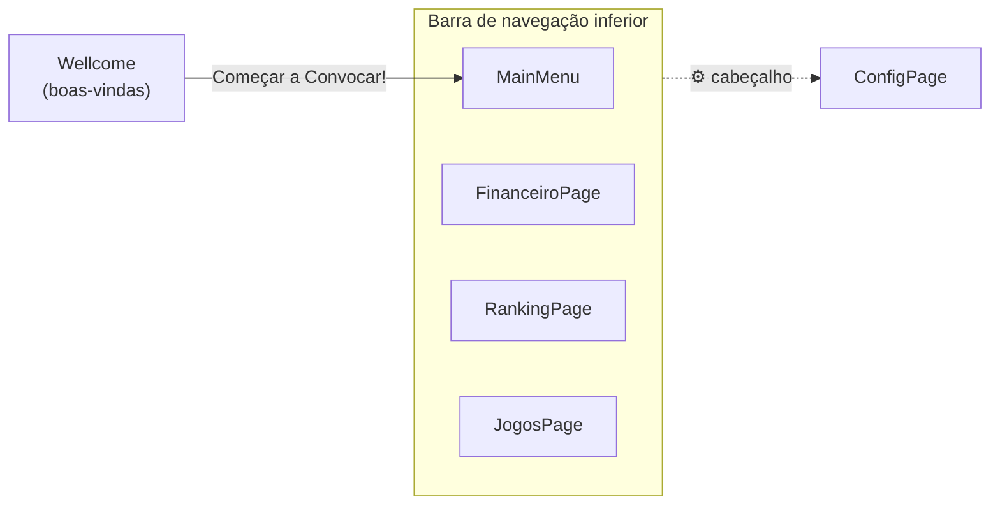

<div align="center">

**🇧🇷 Português** 

# ⚽ ConvocaFC

**O app para organizar a sua pelada — do apito inicial ao acerto da quadra.**

Placar, cronômetro, ranking e financeiro do grupo num só lugar, sem planilha e sem bagunça no grupo do WhatsApp.

<p>
  
  
  
  
</p>
<p>
  
  
</p>

[Sobre](#-sobre) · [Funcionalidades](#-funcionalidades) · [Tecnologias](#-tecnologias) · [Como executar](#-como-executar) · [Estrutura](#-estrutura-do-projeto) · [Roadmap](#-roadmap)

</div>

---

## 📋 Sobre

Todo grupo de futebol amador tem as mesmas dores: alguém precisa marcar o tempo, alguém precisa lembrar o placar, alguém precisa cobrar a mensalidade — e ninguém quer ser essa pessoa.

O **ConvocaFC** nasceu para assumir esse papel. É um app Android nativo, escrito em Kotlin com Jetpack Compose, que centraliza tudo o que um grupo precisa para manter a pelada organizada e competitiva.

> 🚧 **Projeto em desenvolvimento ativo.** A navegação e a tela de jogo já funcionam; as demais telas estão sendo construídas. Acompanhe o progresso no [Roadmap](#-roadmap).

## ✨ Funcionalidades

### Disponíveis

- **Placar ao vivo** — contagem de gols dos dois times, com botões para somar e corrigir.
- **Cronômetro de partida** — 10 minutos por padrão, com controles de iniciar, pausar e reiniciar.
- **Navegação completa** — tela de boas-vindas, barra inferior com quatro abas (Financeiro, Home, Ranking e Jogos) e atalho para Configurações no cabeçalho.

### Em construção

- **Confirmação de presença** — quem vai e quem não vai, sem lista no WhatsApp.
- **Controle financeiro** — mensalidades, pagamentos avulsos e despesas do grupo (aluguel da quadra, churrasco…).
- **Ranking** — pontuação dos jogadores por gols, assistências e vitórias.
- **Sorteio de times** — equipes equilibradas com base no nível de cada jogador.
- **Configurações** — duração da partida e placar máximo personalizáveis.

## 📸 Capturas de tela

> As capturas serão adicionadas assim que as telas principais estiverem finalizadas.

<!--
Quando tiver os prints, salve-os em docs/screenshots/ e descomente a tabela abaixo:

<div align="center">

| Boas-vindas | Jogos | Ranking | Financeiro |
|:---:|:---:|:---:|:---:|
|  |  |  |  |

</div>
-->

## 🧰 Tecnologias

| Camada | Tecnologia | Versão |
|---|---|---|
| Linguagem | [Kotlin](https://kotlinlang.org/) | 2.2.10 |
| Interface | [Jetpack Compose](https://developer.android.com/compose) + Material 3 | BOM 2024.09.00 |
| Navegação | [Navigation Compose](https://developer.android.com/develop/ui/compose/navigation) | 2.7.7 |
| Ícones | Material Icons Extended | 1.6.0 |
| Build | Android Gradle Plugin · Gradle (Kotlin DSL) | 9.1.0 · 9.3.1 |
| Dependências | Version Catalog (`gradle/libs.versions.toml`) | — |
| SDK | `compileSdk` / `targetSdk` 35 · `minSdk` 26 | — |

A identidade visual usa fontes personalizadas: **JetBrains Mono** como fonte principal e **Turret Road** como secundária, com **Iceberg** também incluída nos recursos. O tema segue o Material 3 com suporte a modo escuro e cores dinâmicas no Android 12+.

## 🧩 Navegação



| Rota | Tela | Arquivo | Status |
|---|---|---|---|
| `Wellcome` | Boas-vindas | `MainActivity.kt` | 🟢 Funcional |
| `MainMenu` | Home | `MainMenu.kt` | 🟡 Em construção |
| `JogosPage` | Placar e cronômetro | `JogosPage.kt` | 🟢 Funcional |
| `FinanceiroPage` | Financeiro | `FinanceiroPage.kt` | 🟡 Em construção |
| `RankingPage` | Ranking | `RankingPage.kt` | 🟡 Em construção |
| `ConfigPage` | Configurações | `ConfigPage.kt` | 🟡 Em construção |

## 🚀 Como executar

### Pré-requisitos

- **Android Studio** em versão recente, compatível com o Android Gradle Plugin 9.1 ([notas de versão do AGP](https://developer.android.com/build/releases/gradle-plugin)).
- **JDK 21** para o daemon do Gradle. Se você não tiver, o Gradle baixa automaticamente via [Foojay Toolchains](https://github.com/gradle/foojay-toolchains).
- **Android SDK Platform 35**.
- Dispositivo físico ou emulador com **Android 8.0 (API 26)** ou superior.

### Pelo Android Studio

1. Clone o repositório:
   ```bash
   git clone https://github.com/gu5t4v0l/ConvocaFC.git
   ```
2. No Android Studio, vá em **File › Open** e selecione a pasta `ConvocaFC`.
3. Aguarde a sincronização do Gradle terminar.
4. Escolha um dispositivo ou emulador e clique em **Run ▶** (`Shift + F10`).

### Pelo terminal

```bash
git clone https://github.com/gu5t4v0l/ConvocaFC.git
cd ConvocaFC

# Gera o APK de debug
./gradlew assembleDebug

# Instala direto no dispositivo/emulador conectado
./gradlew installDebug
```

O APK gerado fica em `app/build/outputs/apk/debug/app-debug.apk`.

> 💡 No Windows, use `gradlew.bat` no lugar de `./gradlew`.

### Testes

```bash
./gradlew test                  # testes unitários
./gradlew connectedAndroidTest  # testes instrumentados (requer dispositivo ou emulador)
```

## 📁 Estrutura do projeto

```
ConvocaFC/
├── app/
│   └── src/main/
│       ├── java/com/gl/convocafc/
│       │   ├── MainActivity.kt          # Ponto de entrada, NavHost e tela de boas-vindas
│       │   ├── MainMenu.kt              # Home
│       │   ├── JogosPage.kt             # Placar dos times + cronômetro
│       │   ├── FinanceiroPage.kt        # Controle financeiro
│       │   ├── RankingPage.kt           # Ranking de jogadores
│       │   ├── ConfigPage.kt            # Configurações
│       │   ├── CompsRecyclable/         # Componentes reutilizáveis
│       │   │   ├── BottomNavBar.kt      # Scaffold com cabeçalho e barra inferior
│       │   │   ├── HeaderBar.kt         # TopAppBar com atalho para configurações
│       │   │   └── Utils.kt             # Utilitários (ex.: formatTimer)
│       │   └── ui/theme/                # Cores, tipografia, fontes e tema Material 3
│       └── res/
│           └── font/                    # JetBrains Mono, Turret Road e Iceberg
├── gradle/
│   └── libs.versions.toml               # Version Catalog
├── build.gradle.kts
└── settings.gradle.kts
```

## 🧭 Roadmap

- [x] Navegação entre telas com Navigation Compose
- [x] Cabeçalho e barra de navegação inferior reutilizáveis
- [x] Placar dos dois times
- [x] Cronômetro com iniciar, pausar e reiniciar
- [ ] Tela de configurações (duração da partida e placar máximo)
- [ ] Cadastro de jogadores
- [ ] Confirmação de presença
- [ ] Controle financeiro do grupo
- [ ] Ranking de jogadores
- [ ] Sorteio de times equilibrados
- [ ] Persistência local com Room
- [ ] Arquitetura MVVM com ViewModel e injeção de dependência
- [ ] Organização das telas em pacotes por funcionalidade

## 🤝 Contribuindo

Contribuições são muito bem-vindas! Para contribuir:

1. Faça um **fork** do projeto.
2. Crie uma branch para sua feature:
   ```bash
   git checkout -b feature/minha-feature
   ```
3. Faça commit das suas alterações:
   ```bash
   git commit -m "Adiciona minha feature"
   ```
4. Envie para o seu fork:
   ```bash
   git push origin feature/minha-feature
   ```
5. Abra um **Pull Request** descrevendo o que mudou e por quê.

Encontrou um bug ou tem uma ideia? Abra uma [issue](https://github.com/gu5t4v0l/ConvocaFC/issues).

## 📄 Licença

Distribuído sob a licença MIT. Veja o arquivo [`LICENSE`](LICENSE) para mais detalhes.

## 🙏 Créditos

As fontes [JetBrains Mono](https://www.jetbrains.com/lp/mono/), [Turret Road](https://fonts.google.com/specimen/Turret+Road) e [Iceberg](https://fonts.google.com/specimen/Iceberg) são distribuídas sob a [SIL Open Font License 1.1](https://openfontlicense.org/).

## 👤 Autor

**Gustavo Lima** — [@gu5t4v0l](https://github.com/gu5t4v0l)

---

<div align="center">
  <sub>Feito com ⚽ e ☕ no Brasil.</sub>
</div>
